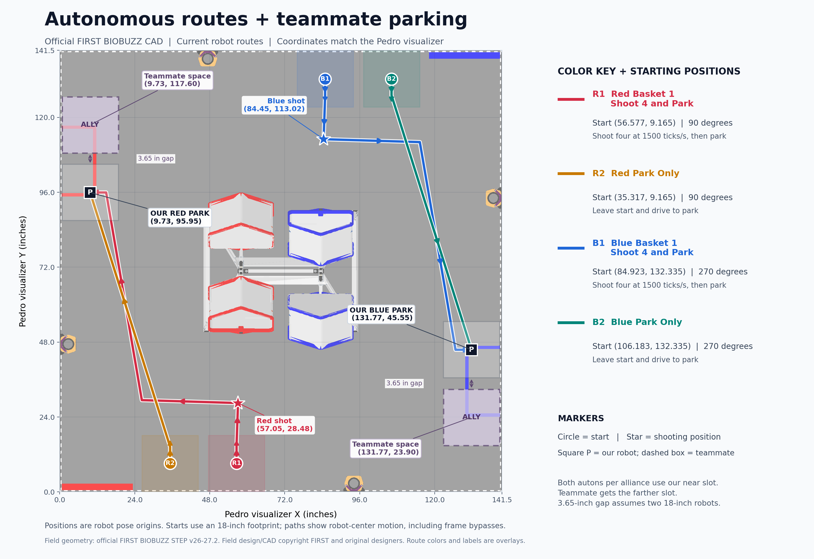

# Flowerless autonomous setup

There are eight selectable autonomous programs under **26123 Flowerless**. Existing routine choices remain available.

| Red | Blue | Full sequence |
| --- | --- | --- |
| Red Basket 1 Shoot 4 and Park | Blue Basket 1 Shoot 4 and Park | Drive to the fixed shooting mark, use the team Shooter default for four preloads, then park. |
| Red Park Only | Blue Park Only | Leave the separate Park Only wall mark and drive around the frame to park. |
| Red Shoot 4 + Garden and Park | Blue Shoot 4 + Garden and Park | Same four-preload opening, collect only our garden, then park carrying the pollen for TeleOp. |
| Red Basket 2 Wait 15 Shoot 4 and Park | Blue Basket 2 Wait 15 Shoot 4 and Park | Start at the opposite wall, aim/spin up during the first 15 seconds with feeders off, then shoot four into raised Basket 2 and park. Teammate required. |

The delayed Basket 2 routines have [different starting marks, a setup map and teammate requirements](BASKET-TWO-WAIT15.md). Do not place them at the Basket 1 starts.

The two new garden routes have their own [route map, simulation results and setup requirements](GARDEN-PARK.md). The four original routes are shown below.

The field image uses the official FIRST BIOBUZZ STEP CAD v26-27.2 bundled with the simulator. Colored footprints, arrows, basket labels, and parking markers are setup overlays. Source attribution and conversion details are in [the simulator field provenance](https://github.com/d-mankotia/BIOBUZZ-sim/blob/main/FIELD-SOURCES.md).

| Routine family | Red robot center (m) | Red Pedro heading | Blue robot center (m) | Blue Pedro heading |
| --- | --- | --- | --- | --- |
| Shoot 4 and Park | (-0.360, -1.564259) | 90 degrees | (+0.360, +1.564259) | 270 degrees |
| Shoot 4 + Garden and Park | (-0.360, -1.564259) | 90 degrees | (+0.360, +1.564259) | 270 degrees |
| Park Only | (-0.900, -1.564259) | 90 degrees | (+0.900, +1.564259) | 270 degrees |
| Basket 2 Wait 15 | (-0.245, +1.564259) | 270 degrees | (+0.245, -1.564259) | 90 degrees |

Coordinates refer to the robot's pose origin at the field center convention. Positive X points right and positive Y points up in the map. All starting arrows point into the field. Place the robot at the exact selected mark before Start. Initialize sets Pinpoint to that mark.

## Parking with a teammate

Every routine parks in the half of our parking zone nearer the wall it started from; the teammate parks in the half nearer theirs. The Basket 1, Garden and Park Only routines start on the far wall and use **our near slot**. Basket 2 Wait 15 starts on the parking-zone wall, so it parks at Blue **(127.88, 21.27)** / Red **(13.62, 120.23)** and leaves the near slot Blue **(131.77, 45.55)** / Red **(9.73, 95.95)** for the teammate. Positions below use Pedro visualizer inches. Blue mirrors Red by a 180-degree rotation about field center.

| Alliance | Our robot parks (X, Y) | Reserved teammate center (X, Y) | Heading |
| --- | --- | --- | --- |
| Red | (9.73, 95.95) | (9.73, 117.60) | 90 degrees |
| Blue | (131.77, 45.55) | (131.77, 23.90) | 270 degrees |

The robot-code parking centers are Red (-1.451, +0.64) m and Blue (+1.451, -0.64) m (about 4 inches off the wall); Blue Basket 2 Wait 15 uses its own point above. The reserved teammate centers are Red (-1.55, +1.19) m and Blue (+1.55, -1.19) m. Two 18-inch square robots have a 3.65-inch gap at these marks. The routes avoid the reserved footprint even when a teammate is already parked there. The dashed boxes are suggested teammate spaces, not an autonomous command for their robot. Coordinate the teammate's approach and confirm their actual footprint and the event's parking requirements.

The original four route colors identify alternative programs; only one runs on our robot. Circles mark starting poses, stars mark shooting positions, and P squares mark our own final slots. Shoot 4 + Garden and Park uses the same parking centers, facing 270 degrees Red / 90 degrees Blue. It leaves the same 3.65-inch gap to the reserved teammate slot.

[Download the printable route and parking map](autonomous-route-map.pdf).

## Fixed shooting positions

These coordinates use the Pedro visualizer's bottom-left origin, in inches, on its 141.5-inch playable field. Robot code uses field-centered inches, so it subtracts 70.75 from both coordinates.

| Alliance | Visualizer X, Y (in) | Robot X, Y (in) | Heading |
| --- | --- | --- | --- |
| Red | (57.0146, 27.4806) | (-13.7354, -43.2694) | About 87.97 degrees |
| Blue | (84.4854, 114.0194) | (+13.7354, +43.2694) | About 267.97 degrees |

Both shooting families now stop exactly one inch backwards along the aim line from the previous marks, away from the hive. Blue is a 180-degree rotation about field center. Starting marks above are unchanged. Shoot 4 and Park clears the wall, drives to its fixed mark facing Basket 1, stops, calls the existing team Shooter class, and then parks outside the metal frame. Shooter uses its default 1500 ticks/second preset and existing PIDF, voltage compensation and feeder readiness. This value is encoder ticks/second, not a new RPM calculation.

There are no camera requirements for any selectable auton. Recovery remains unregistered. Release events are estimated from recovered flywheel load dips and intake encoder travel. In the original Shoot 4 and Park, four estimated releases end shooting; a 14-second shooting timeout or the return-path reserve leads to parking even if fewer releases were observed. Physical robot trials must validate feeding and shot accuracy at the supplied mark. The new garden program uses the same opening, then reserves time to park with the collected pollen for TeleOp.

See [hardware and feeder setup](POLLEN-AUTONOMOUS.md).
