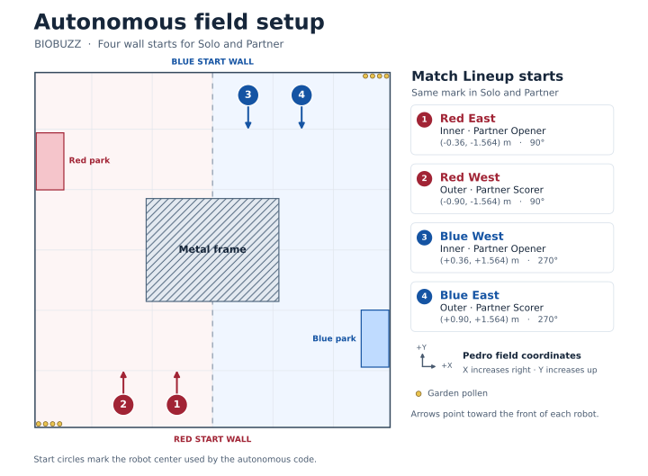

# Solo and partner autonomous lineup

Choose an OpMode under **26123 Match Lineup**. Each row uses the same wall mark for both modes. Positions are field-centered meters and headings use Pedro's convention: 0° faces +X, 90° faces +Y. Place the rear of the robot against the wall with its front pointing into the field.

| Wall mark | Robot center (X, Y) | Heading | Solo OpMode | Partner OpMode |
| --- | --- | --- | --- | --- |
| Red East (inner) | (-0.36, -1.564) | 90° | 26123 Red East Solo | 26123 Red East Partner (Opener) |
| Red West (outer) | (-0.90, -1.564) | 90° | 26123 Red West Solo | 26123 Red West Partner (Scorer) |
| Blue West (inner) | (+0.36, +1.564) | 270° | 26123 Blue West Solo | 26123 Blue West Partner (Opener) |
| Blue East (outer) | (+0.90, +1.564) | 270° | 26123 Blue East Solo | 26123 Blue East Partner (Scorer) |

**Solo.** Run the Rush flower and garden cycles from the selected wall mark. The route uses outer-frame paths and reserves time to reach the loading zone.

**Park Only.** Choose `26123 Red East Park Only`, `26123 Red West Park Only`, `26123 Blue East Park Only`, or `26123 Blue West Park Only`. Use the corresponding mark and heading on the map. The robot leaves the wall, takes the outside route around the frame, and stops in its alliance's loading zone. It uses the drivetrain and Pinpoint.

**Partner.** Pair the inner Opener with the outer Scorer on the same alliance. The Opener sends three preload pollen into the opening cell, then backs into the inner handoff spot with the remaining preload for TeleOp. The Scorer owns the outer travel lane, garden pollen, and loading-zone park. It stages outside the frame and waits for a fresh far-cell webcam tag at raised height for at least 0.65 seconds before feeding. The webcam height check uses the configured mount (0.305 m above the floor, 10° upward pitch) and the Pinpoint position. It then shoots its preloads, collects the garden pollen, returns for the second batch, and parks. If the opening hive never turns, the Scorer times out and parks with its preloads.

With another team's robot, agree on the same lane, hive, and park assignments before selecting Partner. The routines use fixed role assignments and the visible hive state. The simulator runs one drivetrain at a time. The partner validation uses an injected opening batch to exercise the hive tip and camera interlock.
