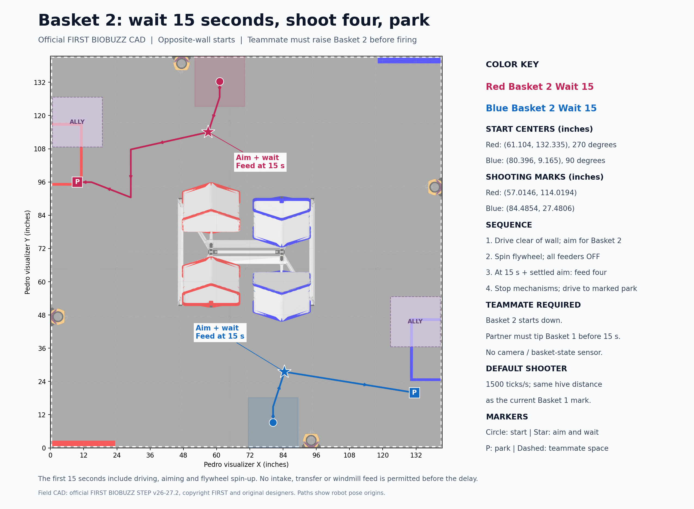

# Basket 2: wait 15 seconds, shoot four, and park

Select **Red Basket 2 Wait 15 Shoot 4 and Park** or **Blue Basket 2 Wait 15 Shoot 4 and Park**, under **26123 Flowerless**. Both are new files directly in `Auton`; existing routines remain registered.



## Required teammate sequence

Basket 2 starts down. Your teammate must score into Basket 1 and finish tipping the hive so Basket 2 is raised **before our robot feeds at 15 seconds**. These routines do not use a camera or basket-state sensor. The timer does not prove that the teammate tipped it; agree on this sequence before using this auton. Shooting four pollen into the empty raised Basket 2 does not by itself cause another tip.

The first 15 seconds include driving to the shooting mark, holding aim and spinning up the flywheel. The intake, transfer CRServo and windmill stay off throughout that wait. Feeding requires at least 15.0 seconds on the autonomous clock and 0.25 seconds of settled aim. It is a minimum delay, not a guarantee to fire at precisely 15.000 seconds if aiming is still unsettled.

After four estimated flywheel-load/encoder releases, both Shooter and Intake stop before the robot parks. Brief loss of shooting pose pauses feeding while the follower reacquires aim instead of immediately giving up and parking. The parking reserve can end shooting early if running late, and the 29.7-second cutoff stops all outputs. Telemetry preserves the parking reason and shows the first feed-command time; without a ball sensor the release count remains an estimate.

## Starting positions and shooting marks

Coordinates below are robot pose origins. Visualizer coordinates are inches from the bottom-left of the 141.5-inch field. Headings are Pedro headings (0 points right, 90 up).

| Alliance | Start in visualizer inches | Start in field-centered meters | Start heading | Shooting mark, visualizer inches | Shooting heading |
| --- | --- | --- | --- | --- | --- |
| Red | (61.1043, 132.3350) | (-0.245, +1.564259) | 270° | (57.0146, 114.0194) | About 272.0279° |
| Blue | (80.3957, 9.1650) | (+0.245, -1.564259) | 90° | (84.4854, 27.4806) | About 92.0279° |

Load four pollen. These starts face inward from the wall beside Basket 2, as requested. They are shifted sideways from a direct reflection of the usual Basket 1 start to clear the fixed flower pot on this wall. Place the robot at these marks before initializing; Init sets Pinpoint to the selected mark.

The shooting pose is reflected from the current Basket 1 mark across the field's horizontal centerline, then rotated 180 degrees for Blue. Its horizontal distance to the raised Basket 2 center is exactly the same **27.8468 inches** as the current Basket 1 mark, including the one-inch backoff. The existing Shooter default remains **1500 encoder ticks/second**, using the team's existing PIDF and readiness logic.

Parking uses the half of the zone nearer our starting wall: Red visualizer (13.62, 120.23), heading 270°; Blue (127.88, 21.27), heading 90°. Both drive straight there from the shooting mark, leaving the other half (Red (9.73, 95.95) / Blue (131.77, 45.55)) for the teammate. Coordinate moving teammate traffic separately.

## Implementation

`RedBasket2Wait15Shoot4Park.java` and `BlueBasket2Wait15Shoot4Park.java` use the shared `DelayedBasketTwoAuto` and `DelayedBasketTwoRoute`. They use team Pedro Constants, Pinpoint, Intake and Shooter; no flowers, floor collection or cameras are required.

Shooter has one additive method, `updateSpinupOnly()`. It uses the existing PIDF while calling `Intake.stop()` and never invokes automatic feeding. Normal `Shooter.update()` is unchanged. Driver TeleOp code, the Intake subsystem, the tuned Pedro constants and existing autonomous implementations are unchanged.

## Verification

The revised Blue direct-parking route with the requested 1-inch tolerance passed the actual-code simulator: first feed **15.0107 s**, four shots / four entries, parked **27.7528 s**, all mechanisms off. See [updated results](validation/blue-direct-park-results.json) and [trace](validation/blue-direct-park-traces.csv).

The repeatable live runner executed the actual production Java autonomous, Shooter, Intake and tuned Pedro follower with simulator motors, drivetrain, ball flight, feeder travel and damped hive swing. Its test-only teammate fixture delivered three reserved partner preloads into Basket 1 around four seconds, letting the normal plant tip and settle the hive. It does not inject our robot's pose, inventory or releases. Fixture deliveries are excluded from our shot/hit counts. This tests the agreed teammate-success scenario, not the teammate's robot path or the guarantee that a real teammate will tip on time.

| Routine | First feed command | Four shots / entries | Parked, autonomous clock |
| --- | --- | --- | --- |
| Red Basket 2 Wait 15 | 15.0055 s | 4 / 4 | 26.3171 s |
| Blue Basket 2 Wait 15 | 15.0125 s | 4 / 4 | 26.3644 s |

Both parked with all drive/intake/windmill outputs stopped, no pollen still held and no garden, flower or nectar collection. Both existing Basket 1 Shoot 4 and Park routines also passed the live regression run. See [results](validation/basket-two-wait15-results.json) and [sampled traces](validation/basket-two-wait15-traces.csv).

Additional checks passed:

- 506,622 assertions for the 15-second gate, settle requirement, mirrored starts, equal shooting distance, swept wall/frame/flower-pot/teammate clearance and fallback parking.
- 25 Shooter checks covering all three intake outputs staying off during spin-up, continued flywheel power, normal `update()` feeding and shutdown.
- The upstream Pedro Visualizer collision/timeline engine reports zero collision intervals on the exported eight-segment Red and five-segment Blue routes at 0.20-inch / 1-degree sampling. An invalid frame-crossing negative control is rejected.
- FTC Android `:TeamCode:assembleDebug` succeeds.

These are simulator and build results. Physical feeding, tracking, launch accuracy and teammate timing still require a field trial; no real-world success guarantee is implied.

The table above records the original parking route. The revised Blue direct route and 1-inch position tolerance are verified separately in `validation/blue-direct-park-results.json`.

## Reproduce and view paths

With the simulator alongside the robot checkout:

```powershell
.\tools\auton\run-live-autons.ps1 -Port 8779 -PartnerFixture -Autons @('RedBasket2Wait15Shoot4Park','BlueBasket2Wait15Shoot4Park','RedBasket1Shoot4Park','BlueBasket1Shoot4Park')
```

Run `DelayedBasketTwoChecks` from the same SDK/Pedro stand-in classpath as the existing route checks. Its `--export` option writes the current Java paths as TSV. Exported [Red](pedro/RedBasket2Wait15Shoot4Park.pp.json) and [Blue](pedro/BlueBasket2Wait15Shoot4Park.pp.json) projects are included for interactive Pedro visualizer playback. Regenerate/check them after exporting `build/basket-two-routes.tsv`:

```powershell
python tools/auton/export-pedro-projects.py build/basket-two-routes.tsv
node tools/auton/check-pedro-visualizer.mjs build/pedro-visualizer-reference RedBasket2Wait15Shoot4Park BlueBasket2Wait15Shoot4Park
python tools/auton/render-basket-two-map.py
```

The map uses the official FIRST BIOBUZZ STEP v26-27.2 field tessellation bundled with the simulator. The upstream engine reference and geometry caveats are described in [the garden verification guide](GARDEN-PARK.md).
