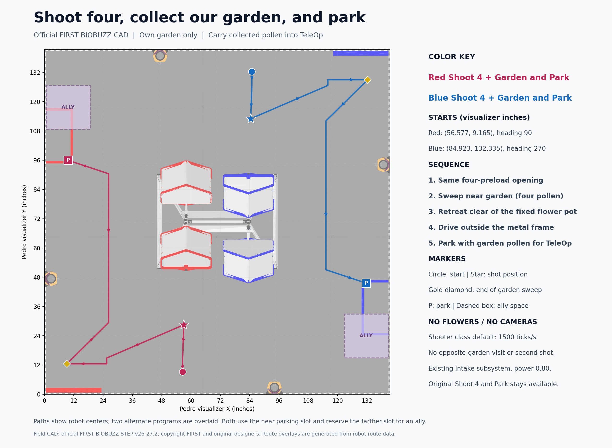

# Shoot four, collect our garden, and park

Select **Red Shoot 4 + Garden and Park** or **Blue Shoot 4 + Garden and Park**. These are separate new files directly in `Auton`. The working Shoot 4 and Park programs remain available. The new routines shoot only the opening batch, collect only our alliance's garden and park carrying that pollen into TeleOp. They never target the opposite garden or a second basket.



## Setup and sequence

Start with four pollen at the same mark as Shoot 4 and Park. Red starts at field-centered (-0.360, -1.564259) meters, Pedro heading 90 degrees; Blue mirrors by 180 degrees, (+0.360, +1.564259), heading 270 degrees. Initialize Pinpoint at the selected starting mark. No flower mechanism or camera is used.

1. Clear the wall and shoot four preloads at the existing fixed mark: Red visualizer (57.05, 28.48), Blue (84.45, 113.02). The existing Shooter class retains its default **1500 encoder ticks/second** and its PIDF/feeder readiness logic.
2. Stop the shooter. Approach our own garden with the intake facing the wall. Run the existing Intake subsystem and keep its windmill stopped, preventing the collected pollen from being shot.
3. Sweep toward our garden corner with a moving hold target at 0.35 m/s, then dwell 0.35 seconds for capture. Pickup is timed; there is no inventory sensor. Expect up to four pollen if the garden remains available.
4. Stop all mechanisms. Retreat inboard before driving along the outside of the metal frame, clearing the fixed flower pot rather than hugging the wall.
5. Park in our near slot, leaving the farther teammate slot clear. Keep the collected pollen for TeleOp; there is no second firing stage.

Park centers are Red visualizer **(9.73, 95.95)** / Blue **(131.77, 45.55)**. Garden-and-Park finishes facing 270 degrees Red / 90 degrees Blue, avoiding a half-turn. Two 18-inch square footprints have the same 3.65-inch gap to the reserved teammate slot. Coordinate actual teammate traffic; the route does not detect moving robots.

## Existing Intake subsystem

The new routines and existing fixed-shot autons use `subsystems.Intake`, with Shooter receiving that same instance. The older `CycleMechanisms` helper also now delegates roller, windmill and transfer commands to this subsystem instead of setting their directions, modes or powers itself. Its direct intake motor reference reads the encoder only.

The branch includes the latest main-branch Intake change, **INTAKE_POWER = 0.80**, without modifying it. Hardware names, directions, inward roller/transfer behavior, windmill commands and stopping behavior come from that class. TeleOp, Shooter, Intake and tuned Pedro constants are unchanged relative to latest main. Park Only does not operate an intake.

## Simulation evidence and limits

The reproducible study uses unmodified simulator `Physics`, `Settings` and `ContactMath`: 86-degree launch elevation, finite capture and feeder travel, ball flight/collisions and damped hive swing. Each case resets the standard field with four robot preloads and the original garden balls. No extra balls or teammate injection are used. The fixture reads the current Intake power constant. Red and Blue produced identical results:

| Bounded drive profile | Parked | Final inventory | Result |
| --- | --- | --- | --- |
| 1.50 m/s, 2.50 m/s² | 11.185 s | Four own-garden pollen | Four opening shots, three entries, one tip |
| 1.30 m/s, 1.60 m/s² | 12.510 s | Four own-garden pollen | Four opening shots, three entries, one tip |
| 0.80 m/s, 0.60 m/s² | 17.765 s | Four own-garden pollen | Four opening shots, three entries, one tip |

All six cases acquired **zero opposite-garden balls, zero flower pollen and zero nectar**, respecting four-ball capacity. The opening's fourth ball misses during the tip in this model; the working opening code has not been changed to compensate.

These are **planning-model results, not an end-to-end run of the FTC OpMode, tuned Pedro follower or physical motors**. Translation follows bounded acceleration/deceleration trajectories; the fixture gates its feeder with simulator release counts and an estimated 0.4-second spin-up. Real code uses the existing flywheel-load/intake-encoder release estimator. Validate pickup at the garden edge, actual feeding and tracking on the robot. The tested drive profiles do not retune Pedro constants.

Incomplete opening shots, stage timeout or the parking reserve cause an early return to park. The 29.7-second cutoff stops all motors; localization or frame-clearance faults stop immediately. Telemetry reports estimated releases and a timed pickup, not an invented sensed inventory or tip count.

## Reproduce

With the simulator alongside this robot checkout, including its built SDK stand-ins, bundled runtime, Pedro library and official field tessellation:

```powershell
.\tools\auton\run-garden-park-sim.ps1 -SimulatorRoot ..\sim-publish
python tools/auton/render-garden-park-map.py
```

The study compiles the current production route, current Intake and simulator plant, checks the main route plus fallback paths, runs six reset-field cases and exports map coordinates. There are **400,348 route assertions** covering mirrored geometry, unchanged opening, frame/wall clearance, fixed flower-pot clearance and the reserved teammate footprint; the physics cases each also sample 6,000 rotated footprints. The map uses official FIRST BIOBUZZ STEP v26-27.2 data bundled in the simulator; see its [field provenance](https://github.com/d-mankotia/BIOBUZZ-sim/blob/main/FIELD-SOURCES.md).
